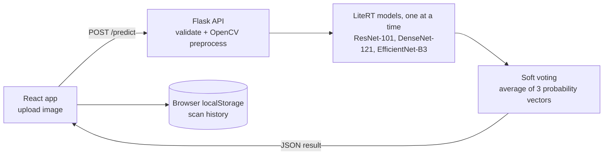

# Skin Disease Detection

**Classifying dermatoscopic skin lesions across seven diagnostic conditions using an ensemble of three deep neural networks.**

 

## About this project

This is my final-year project (project phase) for my B.Tech in Computer Science. It is shared here for viewing and demonstration.

## What the project covers

- **Machine learning:** three models (ResNet-101, DenseNet-121, EfficientNet-B3) trained on the HAM10000 dataset and combined by averaging their predictions.
- **Web application:** a React frontend and a Flask API that returns a predicted condition, a confidence score, and a risk level.
- **Engineering practice:** automated tests, a CI workflow, and written architecture decision records.

The seven conditions it distinguishes are melanoma, basal cell carcinoma, actinic keratoses, vascular lesions, benign keratosis-like lesions, dermatofibroma, and melanocytic nevi. Details are in [Models](docs/MODEL.md).

## Preview

| Diagnostic studio | Scan history | Sample picker |
| :---------------: | :----------: | :-----------: |
|  |  |  |

## System design

In short:

1. You upload a lesion image, or pick a sample image from the HAM10000 test set.
2. The backend resizes and normalizes the image, then runs it through the three models one after another.
3. The three predictions are averaged, and the most likely condition is shown with its confidence and risk level. Scan history is kept only in your browser.

The detailed system diagram, step-by-step request flow, and memory strategy are in [Architecture](docs/ARCHITECTURE.md).

## Tech stack

React 18, Vite, Tailwind CSS, Flask, Google LiteRT, OpenCV, TensorFlow/Keras, Docker, pytest, Vitest.

## Documentation

| Doc | What it covers |
| :-- | :------------- |
| [Architecture](docs/ARCHITECTURE.md) | How the system is structured and how a request flows through it |
| [Models](docs/MODEL.md) | The three networks, ensemble voting, and the seven classes |
| [API](docs/API.md) | Backend endpoints |
| [Deployment](docs/DEPLOYMENT.md) | Where each part is hosted |
| [Development Guide](docs/DEVELOPMENT.md) | Running the project locally |
| [Project Structure](docs/PROJECT_STRUCTURE.md) | Folder layout |
| [ML Pipeline](docs/ML_PIPELINE.md) | Dataset setup, training, and model export |
| [Testing](docs/TESTING.md) | Test suites and how to run them |
| [Decision Records](docs/adr/README.md) | Why key technical choices were made |

## Live Demo

- **Hosted Web App**: [https://skin-disease-detection.vercel.app](https://skin-disease-detection.vercel.app)
- **API Health Check**: [https://skin-disease-detection-6kxm.onrender.com/health](https://skin-disease-detection-6kxm.onrender.com/health)
- **Trained Model Checkpoints**: [Hugging Face Model Hub](https://huggingface.co/purvesh-pj/skin-disease-ensemble)

## Medical Disclaimer

This project is developed for **academic and research demonstration only**. It is not certified as a clinical medical device and must not replace professional dermatological evaluation or biopsy.

## License

This repository is published exclusively for academic review and personal portfolio demonstration. See [LICENSE](LICENSE) for terms.

© 2026 Purvesh Jathade. All rights reserved.