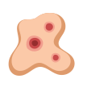
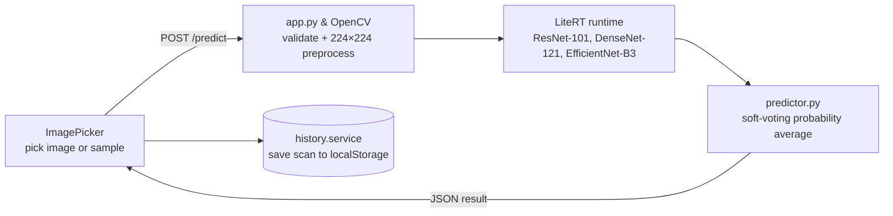

# AI Skin Lesion Classification System

**Classifying dermatoscopic skin lesions across seven diagnostic conditions using an ensemble of three deep neural networks.**

 

| Diagnostic Studio | Scan History | Sample Picker |
| :---------------: | :----------: | :-----------: |
|  |  |  |

## About this project

This is my final-year project (project phase) for my B.Tech in Computer Science. It is shared here for viewing and demonstration.

The project explores dermatoscopic skin lesion classification using deep learning, focusing on three core areas:
- **Machine learning:** three ImageNet-pretrained models (ResNet-101, DenseNet-121, EfficientNet-B3) fine-tuned on the HAM10000 dataset and combined by averaging their predictions.
- **Inference & UI:** a lightweight Flask API and React frontend for uploading lesion images and testing predictions directly.
- **Engineering practice:** 79 automated tests, a CI workflow, and written architecture decision records.

**Target Conditions (HAM10000):**
- **Malignant & Pre-Cancerous:** Melanoma (`mel`), Basal Cell Carcinoma (`bcc`), Actinic Keratoses (`akiec`)
- **Benign & Non-Cancerous:** Melanocytic Nevi (`nv`), Benign Keratoses (`bkl`), Dermatofibroma (`df`), Vascular Lesions (`vasc`)

Details on the ensemble architectures and clinical risk tiers are in [Models](docs/MODEL.md).

## How it works

 
In short:

1. **Input:** `ImagePicker` takes an uploaded lesion photo or test sample and posts it to the backend (`/predict`).
2. **Inference:** `app.py` validates the payload, OpenCV resizes/normalizes it to 224×224, and `LiteRT` executes the three models sequentially.
3. **Consensus & History:** `predictor.py` computes the soft-voting average and clinical risk, returning the diagnosis to the UI while `history.service` saves the scan to browser `localStorage`.

The detailed system diagram, step-by-step request flow, and memory strategy are in [Architecture](docs/ARCHITECTURE.md).

## Tech stack

- **Machine Learning & Vision:** Google LiteRT, TensorFlow / Keras, OpenCV
- **Backend API:** Python, Flask, Gunicorn
- **Frontend UI:** React 18, Vite, Tailwind CSS
- **Testing & Infra:** pytest (Backend/ML), Vitest (Frontend), Docker

## Documentation

| Doc | What it covers |
| :-- | :------------- |
| [Architecture](docs/ARCHITECTURE.md) | How the system is structured and how a request flows through it |
| [Models](docs/MODEL.md) | The three networks, ensemble voting, and the seven classes |
| [API](docs/API.md) | Backend endpoints |
| [Deployment](docs/DEPLOYMENT.md) | Where each part is hosted |
| [Development Guide](docs/DEVELOPMENT.md) | Running the project locally |
| [Project Structure](docs/PROJECT_STRUCTURE.md) | Folder layout |
| [ML Pipeline](docs/ML_PIPELINE.md) | Dataset setup, training, and model export |
| [Testing](docs/TESTING.md) | Test suites and how to run them |
| [Decision Records](docs/adr/README.md) | Why key technical choices were made |

## Live Demo

- **Hosted Web App**: [https://skin-disease-detection.vercel.app](https://skin-disease-detection.vercel.app)
- **API Health Check**: [https://skin-disease-detection-6kxm.onrender.com/health](https://skin-disease-detection-6kxm.onrender.com/health)
- **Trained Model Checkpoints**: [Hugging Face Model Hub](https://huggingface.co/purvesh-pj/skin-disease-ensemble)

## Medical Disclaimer

This project is developed for **academic and research demonstration only**. It is not certified as a clinical medical device and must not replace professional dermatological evaluation or biopsy.

## License

This repository is published exclusively for academic review and personal portfolio demonstration. See [LICENSE](LICENSE) for terms.

© 2026 **Purvesh Jathade**. All rights reserved.

