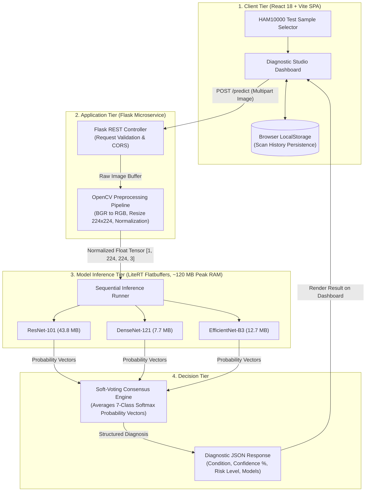

# Architecture

This document explains how the system is structured and how a request moves through it. For the models themselves see [Models](MODEL.md), for endpoints see [API](API.md), and for hosting see [Deployment](DEPLOYMENT.md).

## Contents

1. [System overview](#1-system-overview)
2. [Request lifecycle](#2-request-lifecycle)
3. [Runtime and memory strategy](#3-runtime-and-memory-strategy)

---

## 1. System overview

The app is a stateless inference service. The frontend sends an image, the backend predicts and responds, and nothing about the scan is stored on the server.

| Tier | Responsibility |
| :-- | :-- |
| **Client** | Collects the image, displays the result, and stores scan history in `localStorage`. |
| **Application** | Validates the request and preprocesses the image. |
| **Model inference** | Runs the three models and returns one probability vector from each. |
| **Decision** | Combines the three vectors into one diagnosis. |

---

## 2. Request lifecycle

| Stage | What happens |
| :-- | :-- |
| **1. Upload** | The user selects, drags, or picks a curated sample. Axios sends `POST /predict` with a `multipart/form-data` image. |
| **2. Validation** | The route checks that a file is present and sanitizes the filename with Werkzeug's `secure_filename`. The file is staged temporarily in the backend `uploads/` directory. |
| **3. Preprocessing** | OpenCV reads and validates the image, converts BGR to RGB (`cv2.COLOR_BGR2RGB`), bicubic-resizes to 224×224×3, scales pixels to the range [-1.0, 1.0], and expands to a 4D batch tensor of shape `[1, 224, 224, 3]`. |
| **4. Inference** | The three LiteRT models run **one after another** (see [Section 3](#3-runtime-and-memory-strategy)). Each returns a 7-class probability vector. |
| **5. Consensus** | The three vectors are averaged and the highest probability becomes `predicted_disease`. The result is enriched with a readable condition name, a risk tier, and the list of contributing models. |
| **6. Persistence and cleanup** | The client saves the result to `localStorage` (capped at 50 records). The staged upload is deleted in a `finally` block, so nothing is left on the server. |

---

## 3. Runtime and memory strategy

The backend has to fit inside a 512 MB memory limit. Three choices make that work.

| Choice | Why |
| :-- | :-- |
| **Google LiteRT (`ai-edge-litert`)** instead of full TensorFlow | A standalone, low-memory runtime for `.tflite` flatbuffers that avoids loading the full TensorFlow stack ([ADR 0009](adr/0009-litert-low-memory-runtime.md)). |
| **Sequential inference** | Loading all three models at once risks an out-of-memory kill (`SIGKILL 137`). Each model is loaded, run, and released in turn ([ADR 0004](adr/0004-tflite-low-memory.md)). |
| **Pre-baked model weights** | Model files are copied into the Docker image at build time instead of being downloaded at startup ([ADR 0010](adr/0010-prebaked-model-weights-in-docker.md)). |

How one request runs:

1. **ResNet-101** allocates tensors, evaluates the input, returns its probabilities, and is released.
2. **DenseNet-121** runs next, with garbage collection (`gc.collect()`) in between.
3. **EfficientNet-B3** runs last.

Peak memory for inference stays around 120 MB, and the service as a whole stays under 150 MB.